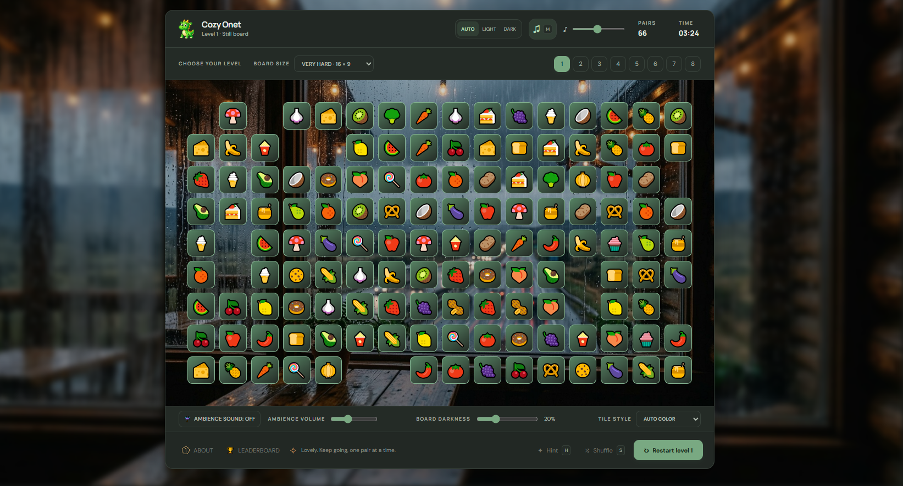
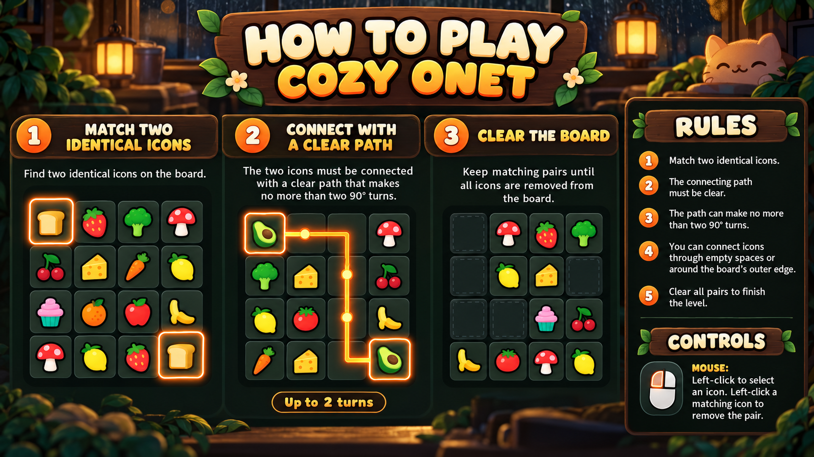
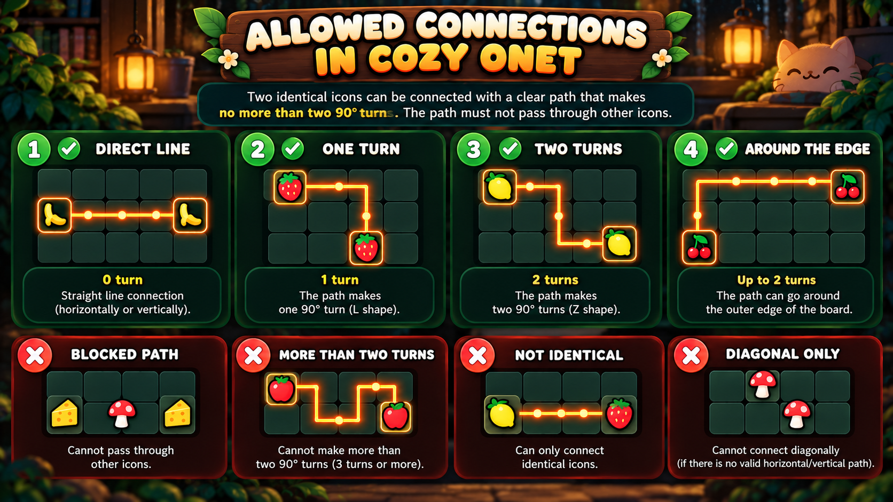

# Cozy Onet

Cozy Onet is a relaxed browser-based Onet tile-matching game inspired by the local `Onet.exe` game. Match pairs of icons, clear each board, and work through eight levels with different tile movement patterns.

## Game Screenshot

## Getting Started

Play online at [sulqwerty.github.io/cozyonet](https://sulqwerty.github.io/cozyonet), or open `index.html` in a modern browser. Select **Start Level** to begin. The default board is **Very Hard (16 × 9)** on desktop and **Easy (12 × 6)** on mobile. Choose a different board size before starting if you prefer a smaller board.

## How to Play

1. Select two identical icons.
2. They match when a clear horizontal or vertical path connects them. The path may make no more than two 90° turns and cannot pass through another tile. It can travel around the outside edge of the board.
3. Keep matching pairs until the board is clear.

Use **Hint** or press `H` to show a valid pair and its path. A pair selected with a hint does not earn match points. **Shuffle** changes the icons in occupied cells without moving tiles; shuffling costs points. Automatic shuffle happens only when no valid match is available.

Successful matches show their connecting path before the tiles clear. Levels also have a completion animation.

## Board Sizes

| Board size | Columns × rows | Tiles | Icon variations | Pairs |
| --- | ---: | ---: | ---: | ---: |
| Very Easy | 8 × 6 | 48 | 12 | 24 |
| Easy | 12 × 6 | 72 | 18 | 36 |
| Medium | 12 × 8 | 96 | 24 | 48 |
| Hard | 15 × 8 | 120 | 30 | 60 |
| Very Hard | 16 × 9 | 144 | 36 | 72 |

Each icon variation appears four times, making two matching pairs. In portrait orientation, the selected board's columns and rows swap automatically while the number of tiles stays the same.

## Levels

Tiles move after a successful match on Levels 2–8. Each tile keeps its identity and follows the level's movement pattern; the board does not randomly rearrange. A shuffle changes icons only, and happens automatically only when no valid match remains.

1. **Still Board** — tiles stay in place.
2. **Move Up** — tiles move upward.
3. **Move Down** — tiles move downward.
4. **Move Left** — tiles move left.
5. **Move Right** — tiles move right.
6. **Move Outward** — the middle clears and the left and right sides move outward.
7. **Move Inward** — the left and right sides clear and tiles move toward the middle.
8. **Move From All Sides** — each quadrant moves toward its nearest corner.

## Appearance and Audio

- **Theme:** Choose **Auto**, **Light**, or **Dark**. Auto follows the system setting. Light uses the forest board background and forest ambience; Dark uses the cozy-cafe background and rain ambience.
- **Tile Style:** **Theme Color** uses the theme's default tile gradient, **Auto Color** changes tile colors for each level, and **Transparent** makes one end of the theme gradient transparent while retaining its other color and the theme's tile border.
- Use **Board Darkness** to adjust the dark overlay on the board background.
- Background music uses `assets/onet.mp3`. It starts when a level begins unless you have turned it off; use the music control or `M` to toggle it. Music and ambience have separate volume controls.
- Rain ambience uses crossfading for smoother looping. Tile clicks, incorrect and correct matches, shuffles, and level completions have sound effects.

## Scoring

- Correct unassisted match: **+20**.
- Manual or automatic shuffle: **−10**.
- Level time bonus, reduced by **10 points per second**:
  - Very Easy: **+4,000**
  - Easy: **+5,500**
  - Medium: **+7,000**
  - Hard: **+8,500**
  - Very Hard: **+10,000**
- Level completion bonus:
  - Very Easy: **+200**
  - Easy: **+400**
  - Medium: **+600**
  - Hard: **+800**
  - Very Hard: **+1,000**

The level's final score includes the time bonus, match points, shuffle penalties, and completion bonus. Continuing with **Next Level** carries that score forward and locks the board size for the rest of the run. Choosing a level from the level buttons starts a separate run with its own score.

## Leaderboard

Only players who complete all eight levels in order using **Next Level** can save a leaderboard entry. The leaderboard records the player's name, final score, completion time, and board size. Scores are stored locally in the current browser.

## Controls

| Input | Action |
| --- | --- |
| Mouse click / tap | Select a tile or matching pair |
| `H` | Show a hint |
| `M` | Toggle background music |
| `S` | Shuffle the board |

## Assets

Game assets, including the logo, icons, backgrounds, ambience, music, sound effects, splash screen, and these how-to-play images, are stored in `assets/`.
